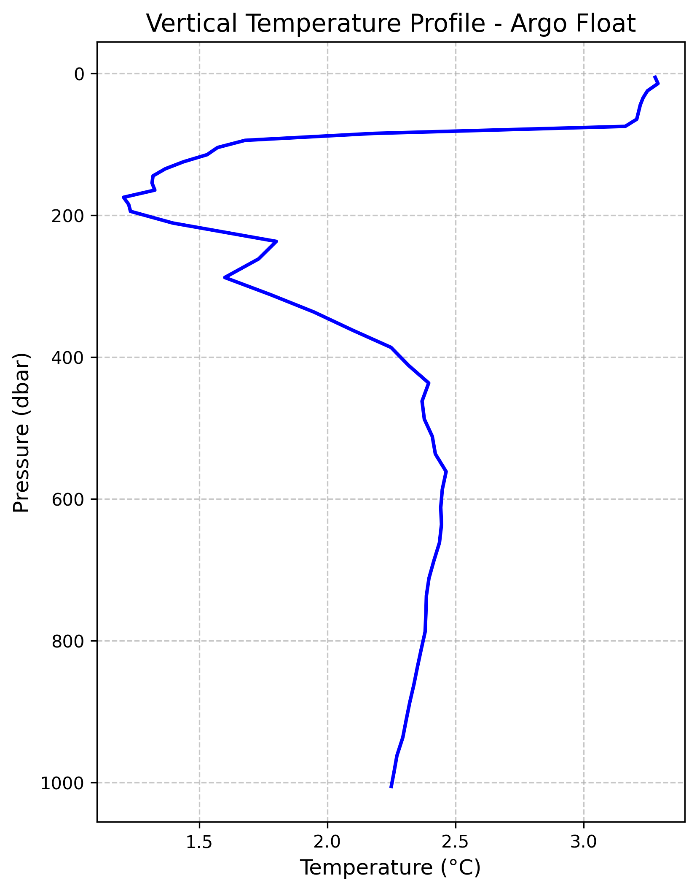

# 01. Argo Temperature Profile

**Question.** What does the vertical temperature structure look like in a single Argo float profile?

**Data.** Argo float 6901814 (Coriolis DAC, Ifremer GDAC), first profile: 2013-01-10, 61.50°S, 178.66°E (Southern Ocean), 0–1000 dbar.

**Method.** Open the profile file with xarray and plot temperature against pressure. No QC flags are applied.

**Finding.** About 3.2–3.3 °C in the upper 80 dbar, a sharp drop to a minimum of about 1.2 °C near 170–190 dbar, a rise to about 2.5 °C near 450–600 dbar, then a slow decrease to about 2.2 °C at 1000 dbar. This is a subsurface temperature-minimum layer.

**Run.** `notebooks/01_argo_analysis.ipynb`. The Argo file is already in `data/`.
