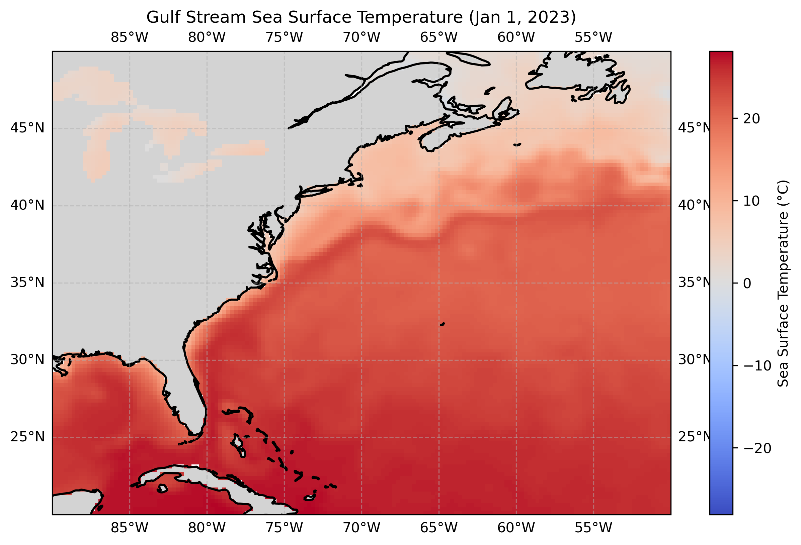

# 02. Gulf Stream SST Map

**Question.** How does the Gulf Stream appear in a single day of sea surface temperature?

**Data.** NOAA OISST daily SST via OPeNDAP (NOAA PSL), 20–50°N, 90–50°W, 2023-01-01.

**Method.** Subset one day and the region with xarray and map SST with Cartopy.

**Finding.** A sharp SST front runs northeast from Cape Hatteras (~35°N) and east along 38–40°N, separating warm subtropical water from colder shelf and slope water.

