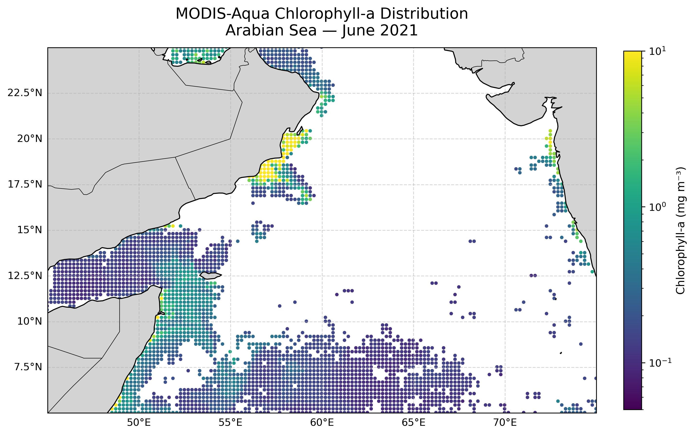

# 03. MODIS-Aqua Chlorophyll-a in the Arabian Sea

**Question.** How is surface chlorophyll-a distributed across the Arabian Sea in early June 2021?

**Data.** MODIS-Aqua 8-day composite chlorophyll-a (NOAA OceanWatch ERDDAP, `aqua_chla_8d_2018_0`), 2021-06-02, 5–25°N, 45–75°E, every 5th grid point.

**Method.** Request a CSV subset from ERDDAP, drop missing and non-positive values, and map on a log colour scale with Cartopy. A single snapshot.

**Finding.** 2,757 of 14,065 points are valid (median 0.155, mean 0.76, maximum 72.0 mg m⁻³). The highest values lie along the coasts of Oman (~17–20°N) and northwest India. Large gaps are most likely clouds.

