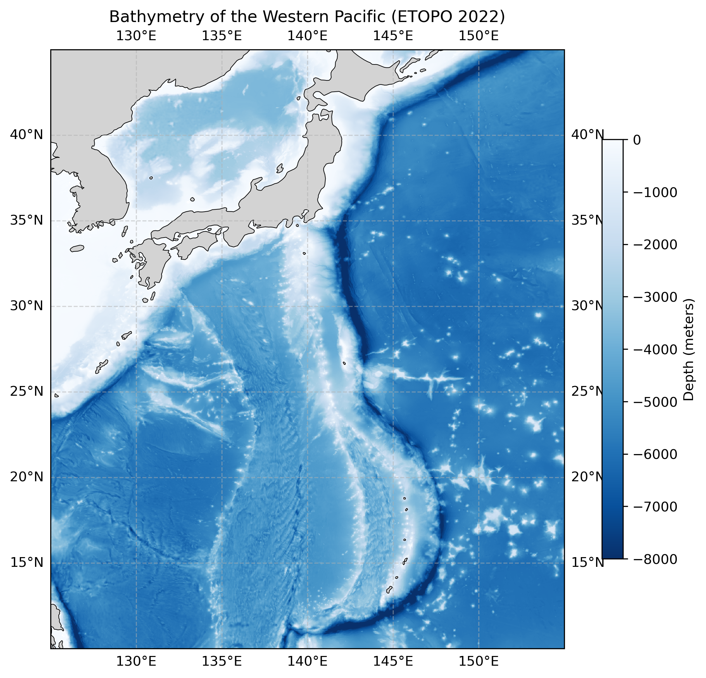

# 04. Western Pacific Bathymetry

**Question.** What are the main seafloor features between Japan and the Mariana Islands?

**Data.** ETOPO 2022 (60 arc-second bedrock elevation) via OPeNDAP (NOAA NCEI), 10–45°N, 125–155°E.

**Method.** Subset the grid, mask land, and map depth with `pcolormesh` (colour scale clipped at 8000 m).

**Finding.** The Japan, Izu–Bonin and Mariana trenches form a continuous arc of the deepest seafloor east of the Izu–Bonin–Mariana ridge. Depths below 8000 m are not resolved in colour.

