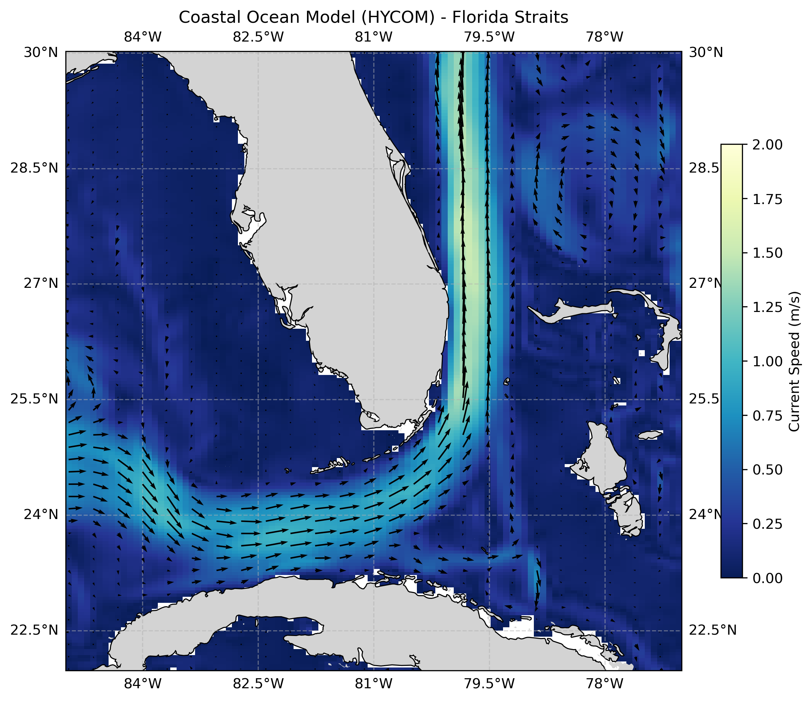

# 05. HYCOM Model Surface Currents, Florida Straits

**Question.** What does the HYCOM surface current field look like in the Florida Straits?

**Data.** HYCOM global analysis `GLBy0.08/expt_93.0` via OPeNDAP, surface level, 22–30°N, 85–77°W, first time step.

**Method.** Compute speed √(u² + v²) from `water_u` and `water_v` and map it with quiver arrows.

**Finding.** The fastest flow (about 1.25–1.5 m/s) is in the Florida Current core between Florida and the Bahamas, fed from the west along the north side of Cuba.

