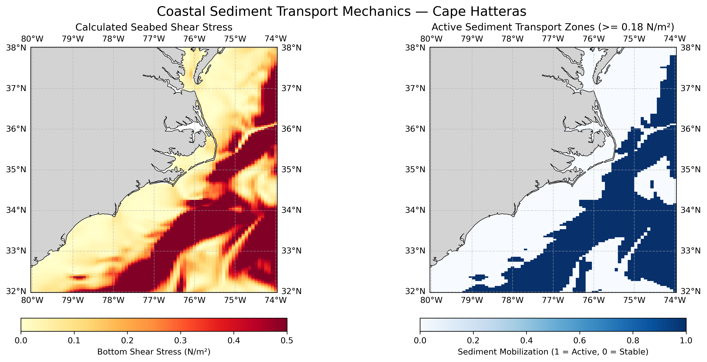

# 06. Drag-Law Stress from HYCOM Surface Currents, Cape Hatteras

**Question.** Where does a quadratic drag law, applied to model surface currents, exceed a typical sand-mobilisation threshold?

**Data.** HYCOM `GLBy0.08/expt_93.0` via OPeNDAP, surface level, 32–38°N, 80–74°W.

**Method.** τ = ρ·C_d·|u|² with ρ = 1025 kg m⁻³ and C_d = 0.0025, flagging cells with τ ≥ 0.18 N m⁻².

**Finding.** The flagged cells follow the Gulf Stream offshore, not the shelf. Because these are **surface** currents, the result reflects the surface flow, not real bed shear stress or sediment transport.

