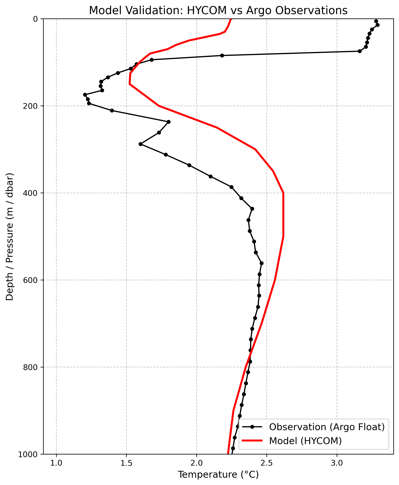

# 07. HYCOM vs Argo Temperature Profile (Model–Observation Comparison)

**Question.** How does a HYCOM temperature profile at the nearest grid point compare with an Argo profile?

**Data.** Argo float 6901814, first profile (2013-01-10, 61.50°S, 178.66°E), and HYCOM `GLBy0.08/expt_93.0` at the nearest grid point, first time step. Upper 1000 m.

**Method.** Select the nearest HYCOM point and plot both temperature profiles. The times are **not** matched (HYCOM starts years after 2013), and pressure (dbar) is plotted against depth (m).

**Finding.** Both show a temperature minimum near 130–200 m with warmer water below. The model is about 1 °C colder at the surface and up to ~0.5 °C warmer at 250–500 m, and the profiles converge below ~750 m. Because the profiles are years apart, the differences are not a measure of model error.

