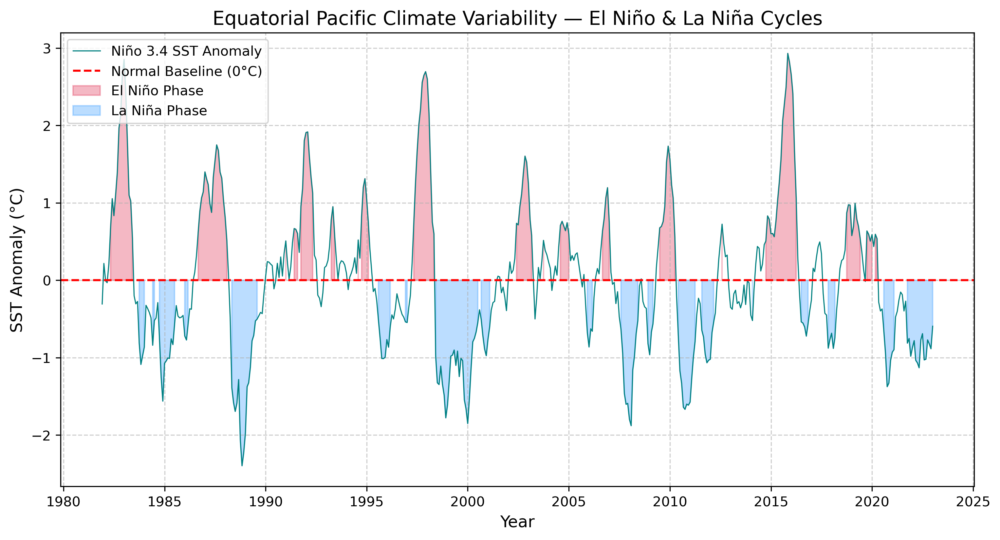

# 08. Niño 3.4 SST Anomalies from NOAA OISST

**Question.** How has monthly SST in the Niño 3.4 region varied since the early 1980s?

**Data.** NOAA OISST v2 monthly mean SST (1°) via OPeNDAP (NOAA PSL), 5°S–5°N, 170–120°W.

**Method.** Area-weighted mean minus the monthly climatology. Months ≥ +0.5 °C are shaded red and ≤ −0.5 °C blue (a simple threshold, not the official ONI).

**Finding.** The largest warm anomalies (+2.5 to +3 °C) are in 1982–83, 1997–98 and 2015–16. The strongest cold anomalies (−2 to −2.4 °C) are in 1988–89, 1999–2000 and 2007–08/2010–11.

