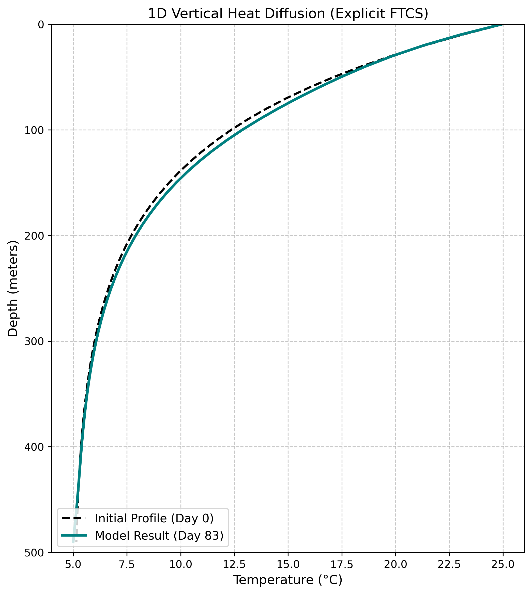

# 09. 1D Vertical Heat Diffusion Model (Numerical Methods)

**Question.** How does an initial thermocline profile evolve under constant vertical diffusion with a seasonal surface temperature?

**Data.** None. The model is defined in the notebook.

**Method.** ∂T/∂t = κ ∂²T/∂z² with an explicit FTCS scheme: κ = 1×10⁻⁴ m² s⁻¹, 50 levels of 10 m, Δt = 1 h for 83.3 days. Initial T(z) = 5 + 20·exp(−z/100 m) °C, surface T = 20 + 5·sin(2πt/365 d) °C, bottom T = 5 °C. Stable, with r = κΔt/Δz² = 0.0036 (limit 0.5). A numerical-methods exercise, not an ocean model.

**Finding.** After 83 days the profile is only slightly warmer between about 50 and 250 m, as expected from the short diffusion length √(κt) ≈ 27 m.

