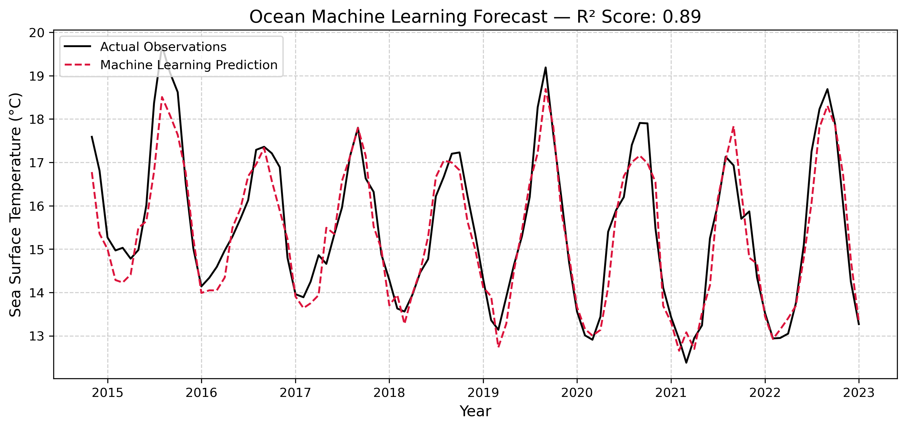

# 10. One-Month-Ahead SST Prediction with a Random Forest

**Question.** How well can a Random Forest predict monthly SST one month ahead?

**Data.** NOAA OISST v2 monthly mean SST (1°), grid point nearest 35°N, 125°W (off California).

**Method.** Features: calendar month and SST 1 and 2 months earlier. `RandomForestRegressor(n_estimators=100)`, first 80% of the record for training and last 20% for testing (chronological split).

**Finding.** On the test period (late 2014 to 2022): R² = 0.888, RMSE = 0.576 °C. Much of the skill likely comes from the seasonal cycle; no persistence or climatology baseline is compared.

