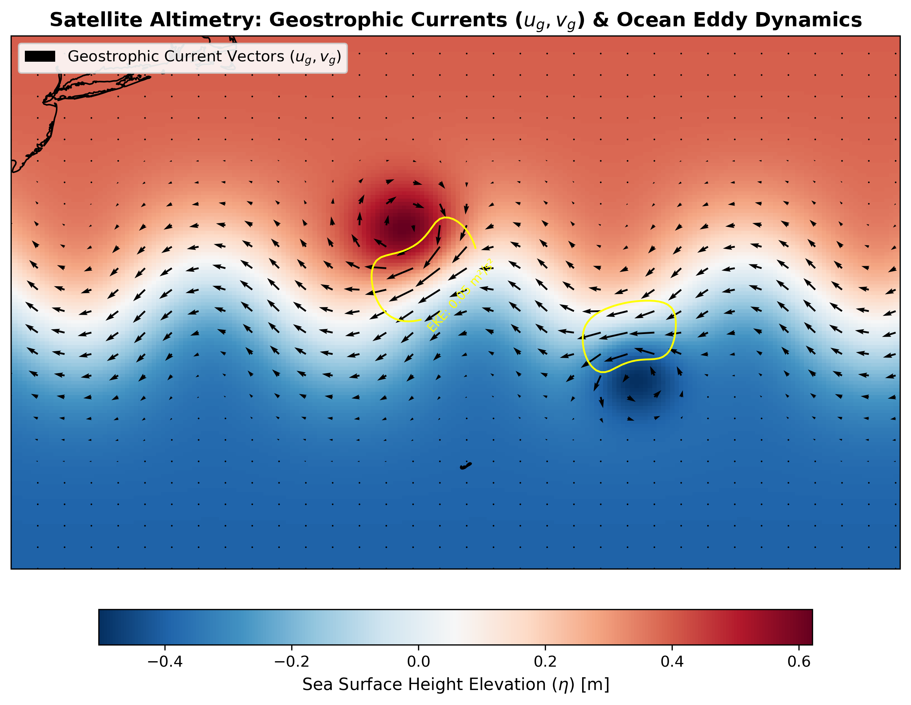

# 11. Geostrophic Velocity from a Synthetic SSH Field

**Question.** What geostrophic velocity field follows from an idealised sea surface height field with a front, a meander and two eddies?

**Data.** **Synthetic** SSH on a 150 × 200 grid (30–42°N, 75–55°W): a tanh front, a meander, and one anticyclonic and one cyclonic Gaussian eddy.

**Method.** u_g = −(g/f) ∂η/∂y and v_g = (g/f) ∂η/∂x with centred differences. The "EKE" in the notebook is the kinetic energy of the total flow, since no time mean is removed.

**Finding.** The velocities follow the SSH contours, as geostrophy requires. The front has higher SSH on its north side, the reverse of the real Gulf Stream, so its jet flows westward.

