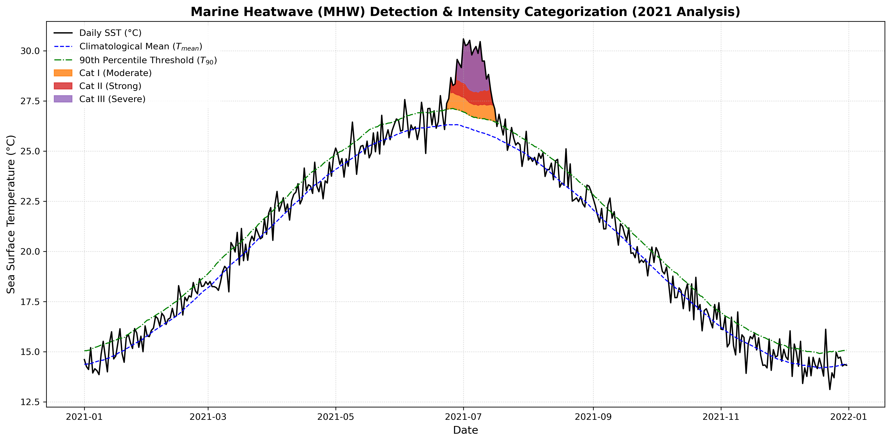

# 12. Marine Heatwave Detection on a Synthetic SST Series

**Question.** Can a Hobday et al. (2016) style threshold method recover a known warm event?

**Data.** **Synthetic** daily SST for 1993–2022: seasonal cycle, 0.015 °C per year trend, noise (σ = 0.6 °C), and an injected warm anomaly (peak 4.2 °C) from 15 June to 25 July 2021.

**Method.** Day-of-year climatology and 90th percentile, smoothed over 11 days. Events are runs of 5 or more days above the threshold, with categories from Hobday et al. (2018). A simplified version of the method.

**Finding.** Exactly 1 event is detected in 30 years, matching the injected 2021 anomaly. It peaks in Category III (Severe).

