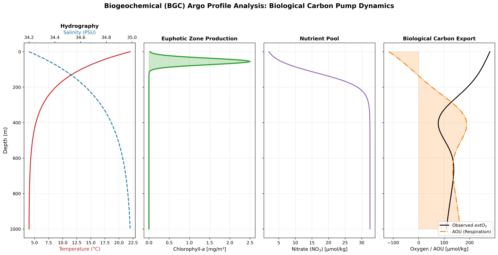

# 13. Apparent Oxygen Utilisation from Synthetic Biogeochemical Profiles

**Question.** How are chlorophyll, nitrate, oxygen and AOU typically arranged in the upper 1000 m?

**Data.** **Synthetic** analytic profiles of temperature, salinity, chlorophyll-a, nitrate and oxygen on 200 levels (0–1000 m). No BGC-Argo data.

**Method.** AOU = O₂,sat − O₂, with O₂,sat from a simple linear placeholder (350 − 6.2·T − 1.5·S µmol kg⁻¹), not the Garcia & Gordon (1992) equation.

**Finding.** By construction, the chlorophyll maximum is at 55 m, nitrate rises through 50–250 m, and AOU peaks near 400 m (about 190 µmol kg⁻¹) at the oxygen minimum. The near-surface AOU of about −120 µmol kg⁻¹ is unrealistic and comes from the placeholder formula. Next step: use the Garcia & Gordon equation (e.g. via `gsw`) or a real BGC-Argo profile.

