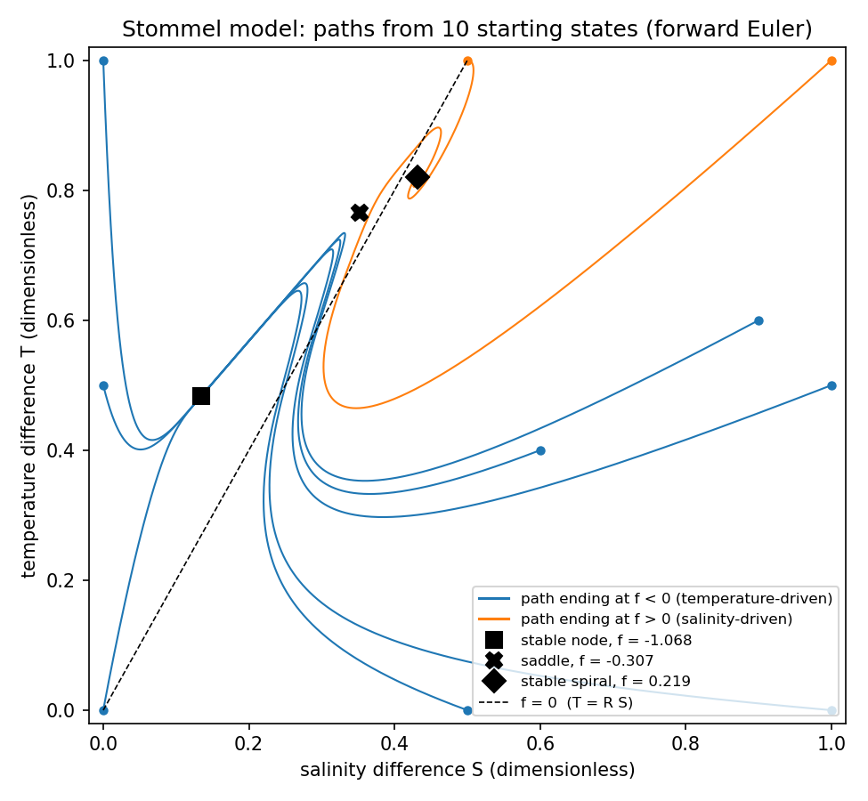
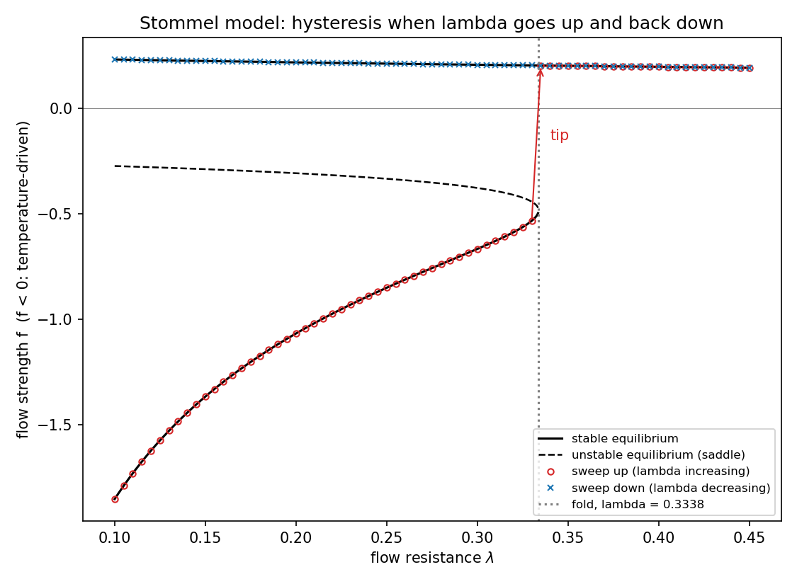
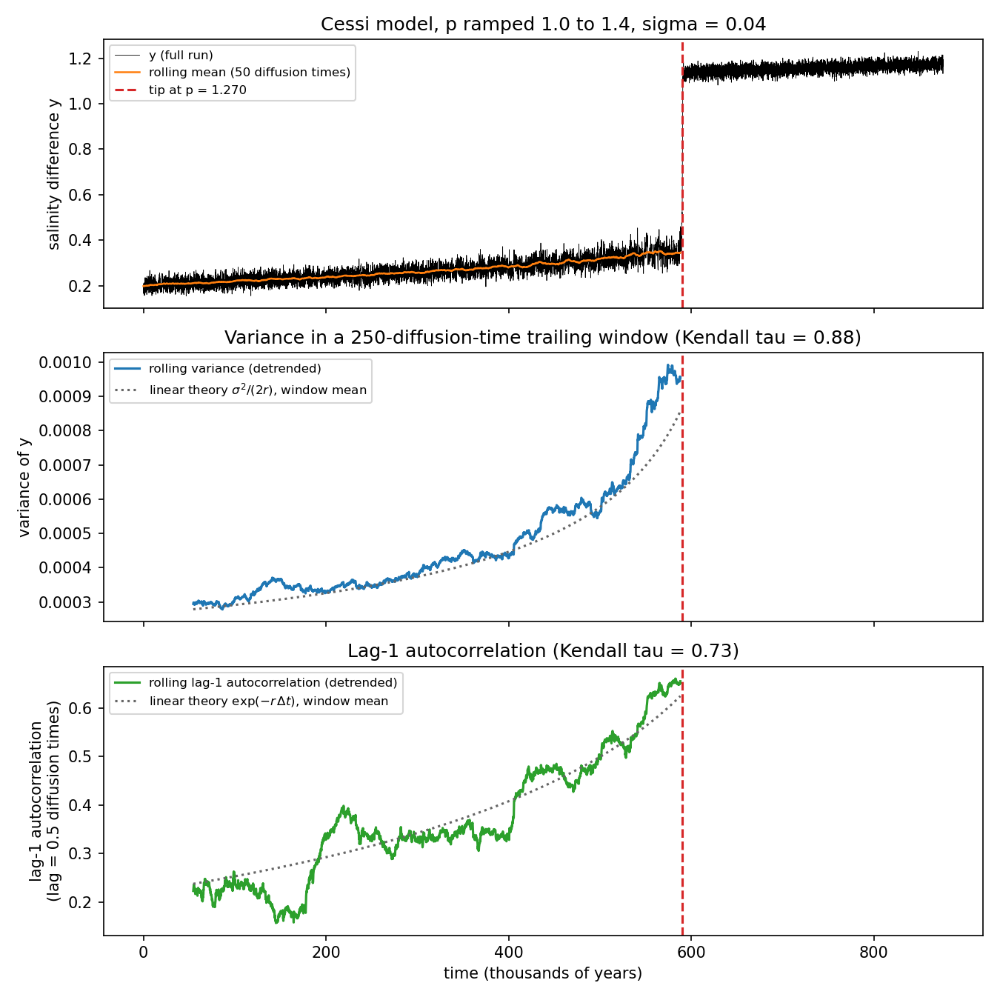

# 14. Tipping points in box models of the overturning circulation

Can the ocean's overturning circulation have two stable states under the same forcing, and what makes it switch? I used the classic box models of Stommel (1961) and Cessi (1994) to study slow changes in forcing, random noise, and early-warning signals before a switch.

## Key results

- **Two stable states.** Stommel's model has a temperature-driven state (f = -1.068) and a salinity-driven state (f = +0.219), separated by a saddle. This needs salinity to be restored more weakly than temperature (R delta = 1/3 < 1).
- **Hysteresis.** Raising the flow resistance lambda, the temperature-driven state disappears at lambda = 0.3338, so the flow jumps to the salinity-driven state. Lowering lambda back to 0.1 does not bring it back. Stommel estimated the fold as "slightly greater than 1/4" from his hand-drawn graph.
- **Noise-driven flips.** With noise, Cessi's model flips at random between states. The mean waiting times follow Kramers' law: fitted slope 0.1188 ± 0.0026 against the predicted 0.1142.
- **Early warning.** Before tipping, variance and lag-1 autocorrelation rise. Over 100 runs, Kendall tau was 0.775–0.912 (variance) and 0.664–0.855 (autocorrelation), against -0.30 to 0.35 in 100 control runs with no fold. The test is retrospective: it uses the known tip time.
- **Toy Antarctic model (exploratory, my own).** Whether a melt–freshening–mixing feedback gives a threshold depends on the mixing law: kappa0/(1 + F/F0) gives none, kappa0 exp(-F/F0) gives folds at 3.149 and 3.505 °C above freezing.







**Checks.** My three Stommel equilibria (-1.0679, -0.3070, +0.2191) and their stability types match Stommel's Table I (-1.1, -0.30, +0.23). Cessi's equilibria at p = 1.1 match Yang et al. (2021) to four decimals, and the fold at p = 1.2962 matches Cessi's "about 1.3".

## Notebooks

| Notebook | Content |
| :--- | :--- |
| `01_stommel_equilibria` | Equilibria, stability from the Jacobian, trajectories |
| `02_stommel_hysteresis` | Slow ramp of lambda up and down, fold location |
| `03_cessi_landscape` | Equilibria, folds and potential of Cessi's model |
| `04_cessi_noise` | Stochastic runs, Kramers' law, mean first-passage time |
| `05_early_warning` | Variance and autocorrelation before tipping, 100 runs + 100 controls |
| `06_antarctic_toy_model` | Exploratory ice-shelf feedback model |

The model equations are in `src/models.py`.

## Limitations

- Dimensionless boxes: no winds, rotation, geography or vertical structure.
- White, additive noise and a single forcing parameter.
- The early-warning test uses one noise level, ramp speed and parameter set.
- The toy Antarctic model's parameters are order-of-magnitude guesses.

## How to run

```bash
conda env create -f environment.yml
conda activate ocean-portfolio
jupyter lab
```

Run the notebooks in `notebooks/` in order (01 to 06). They import `../src/models.py` and save figures to `../figures/`.

## References

- Cessi, P. (1994). A simple box model of stochastically forced thermohaline flow. Journal of Physical Oceanography, 24(9), 1911–1920. https://doi.org/10.1175/1520-0485(1994)024<1911:ASBMOS>2.0.CO;2
- Dakos, V., et al. (2008). Slowing down as an early warning signal for abrupt climate change. PNAS, 105(38), 14308–14312. https://doi.org/10.1073/pnas.0802430105
- Ditlevsen, P. D., & Johnsen, S. J. (2010). Tipping points: Early warning and wishful thinking. Geophysical Research Letters, 37(19). https://doi.org/10.1029/2010GL044486
- Hazel, J. E., & Stewart, A. L. (2020). Bistability of the Filchner-Ronne Ice Shelf cavity circulation and basal melt. JGR: Oceans, 125(4), e2019JC015848. https://doi.org/10.1029/2019JC015848
- Held, H., & Kleinen, T. (2004). Detection of climate system bifurcations by degenerate fingerprinting. Geophysical Research Letters, 31(23). https://doi.org/10.1029/2004GL020972
- Hellmer, H. H., et al. (2012). Twenty-first-century warming of a large Antarctic ice-shelf cavity by a redirected coastal current. Nature, 485(7397), 225–228. https://doi.org/10.1038/nature11064
- Kramers, H. A. (1940). Brownian motion in a field of force and the diffusion model of chemical reactions. Physica, 7(4), 284–304. https://doi.org/10.1016/S0031-8914(40)90098-2
- Lenton, T. M., et al. (2008). Tipping elements in the Earth's climate system. PNAS, 105(6), 1786–1793. https://doi.org/10.1073/pnas.0705414105
- Stommel, H. (1961). Thermohaline convection with two stable regimes of flow. Tellus, 13(2), 224–230. https://doi.org/10.1111/j.2153-3490.1961.tb00079.x
- Yang, F., Sun, X., & Duan, J. (2021). On the abrupt change of the maximum likelihood state in a simplified stochastic thermohaline circulation system. Chaos, 31(2), 021103. https://doi.org/10.1063/5.0037083
