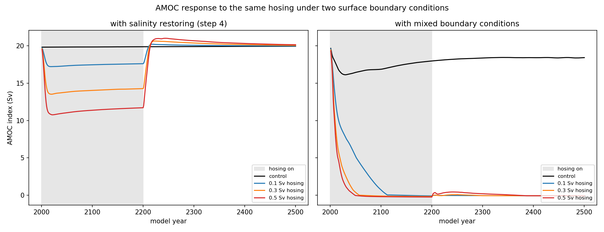
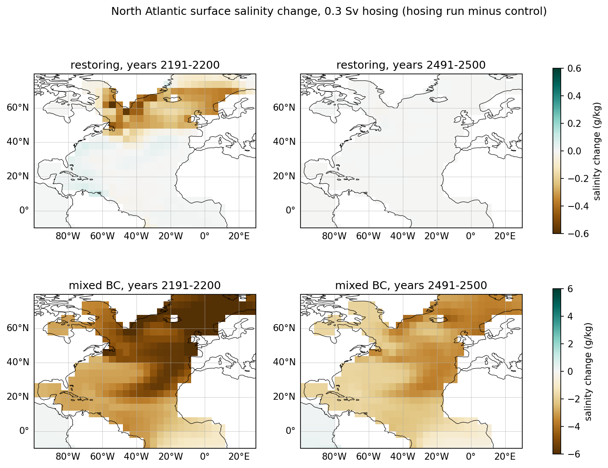

# 15. Freshwater hosing in MITgcm: does the AMOC have two stable states?

How does the Atlantic overturning circulation (AMOC) respond to extra freshwater in the North Atlantic, and does the surface salinity boundary condition change the answer? I added 0.1, 0.3 and 0.5 Sv of freshwater in MITgcm, once with surface salinity restoring and once with mixed boundary conditions. This follows project 14, where Stommel's box model showed two stable states.

## Setup

- MITgcm `checkpoint69q`, experiment `tutorial_global_oce_latlon`: global 4° grid, 15 levels, monthly forcing repeated every year.
- 2000-year spin-up: AMOC 19.80 Sv, drifting +0.042 Sv per century.
- Hosing over 50–70°N, 60°W–20°E for 200 years, then 300 years without it.
- AMOC index: maximum Atlantic overturning between 20°N and 60°N, below 500 m (resolved flow only, without the GM eddy part).
- Accelerated time stepping (tracers 1 day, momentum 30 min): equilibrium states are reliable, time scales of change are not.

## Key results

- **With salinity restoring,** the AMOC weakened by 11–41% and fully recovered in every run. The restoring removed 80–87% of the added freshwater in the hosing region.
- **With mixed boundary conditions,** every run collapsed to an AMOC of about zero and stayed off for 300 years after the hosing stopped, even at 0.1 Sv. The deep overturning cell (about 18 Sv in the control) disappeared.
- At 0.3 Sv the hosing region freshened by 0.30 g/kg with restoring (back to normal 300 years later), but by 5.77 g/kg with mixed boundary conditions (still 3.04 g/kg fresher 300 years later).





## Checks

- My build reproduces the official reference output to at least 10 significant digits.
- The forcing files add exactly 0.1, 0.3 and 0.5 Sv.
- The change in global mean salinity matches the added freshwater and restoring to within 0.2% in every hosing run.
- Every final run passed a check for NaN, unrealistic values and sub-freezing temperatures.

## Limitations

- Coarse 4° grid, no atmosphere or sea ice, and a closed wall at 80°N (no Arctic).
- Switching to mixed boundary conditions is itself a shock: the control AMOC dropped from 19.66 to 16.12 Sv before recovering, and the hosing started during that adjustment. The control recovered and the hosing runs did not.
- The mixed runs use a flux-limited advection scheme (33), because the centred scheme blew up in the 0.5 Sv run. Its control is about 18 Sv instead of 19.7 Sv, so each run is compared with its own control.
- One run per case; the idealized hosing raises global sea level.

## Notebooks

| Notebook | Content |
| :--- | :--- |
| `01_build_and_verify` | Build, reference-output check, timing |
| `02_spinup` | 2000-year spin-up, Atlantic mask, AMOC index, drift and salt budget |
| `03_make_hosing_forcing` | Hosing forcing files (0.1, 0.3, 0.5 Sv) |
| `04_hosing_with_restoring` | Hosing with salinity restoring |
| `05_mixed_boundary_conditions` | Switch to mixed boundary conditions, 500-year control |
| `06_hosing_with_mixed_bc` | Hosing with mixed boundary conditions, numerical failure and fix |
| `07_compare_and_check` | Summary of all runs and salt-budget checks |

## How to reproduce

The MITgcm source and all runs (about 4 GB) live outside the repository. Requirements: macOS on Apple silicon with Homebrew `gfortran`, `make` and netCDF, plus the repository's conda environment and MITgcmutils.

```bash
# Get MITgcm and its Python reader
git clone --depth 1 --branch checkpoint69q https://github.com/MITgcm/MITgcm.git ~/models/MITgcm
python -m pip install --no-deps ~/models/MITgcm/utils/python/MITgcmutils

# Build (from inside project_15_mitgcm_freshwater_hosing/)
T=~/models/MITgcm/verification/tutorial_global_oce_latlon
bash scripts/build.sh $T/code ~/mitgcm_runs/hosing/build_reference_ieee ieee
bash scripts/build.sh $T/code ~/mitgcm_runs/hosing/build_spinup_fast fast experiments/spinup/code
bash scripts/build.sh $T/code ~/mitgcm_runs/hosing/build_safe_fast fast experiments/safety_code

# Run
bash scripts/run_experiment.sh ~/mitgcm_runs/hosing/build_reference_ieee $T/input ~/mitgcm_runs/hosing/reference_test_ieee
bash scripts/run_experiment.sh ~/mitgcm_runs/hosing/build_spinup_fast $T/input ~/mitgcm_runs/hosing/spinup experiments/spinup/input
bash scripts/run_hosing_set.sh restore experiments/hosing_forcing ~/mitgcm_runs/hosing/spinup
BUILD=~/mitgcm_runs/hosing/build_safe_fast bash scripts/run_hosing_set.sh mixed experiments/mixed_forcing ~/mitgcm_runs/hosing/spinup experiments/mixed_forcing/emp_mixed.bin
```

The spin-up takes about 2.6 hours and each hosing set 1.2–1.5 hours. Run notebook 03 before the restoring set, and notebook 05 up to "Part B" before the mixed set. Then run the notebooks 01 to 07 in order; they read the runs from `~/mitgcm_runs/hosing/`.

## References

- Stommel, H. (1961). Thermohaline convection with two stable regimes of flow. Tellus, 13, 224-230.
- Bryan, F. (1986). High-latitude salinity effects and interhemispheric thermohaline circulations. Nature, 323, 301-304.
- Rahmstorf, S., et al. (2005). Thermohaline circulation hysteresis: A model intercomparison. Geophysical Research Letters, 32, L23605.
- Lenton, T. M., et al. (2008). Tipping elements in the Earth's climate system. PNAS, 105, 1786-1793.
- MITgcm documentation: https://mitgcm.readthedocs.io
