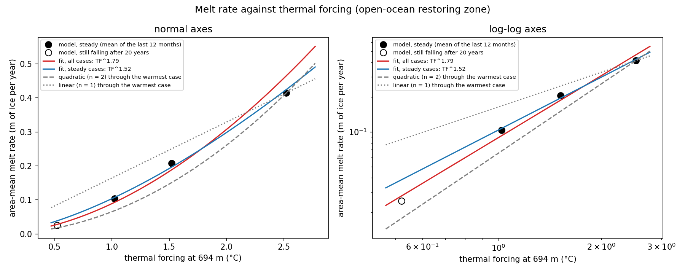
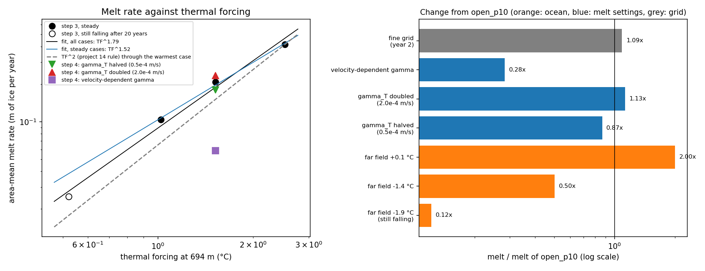
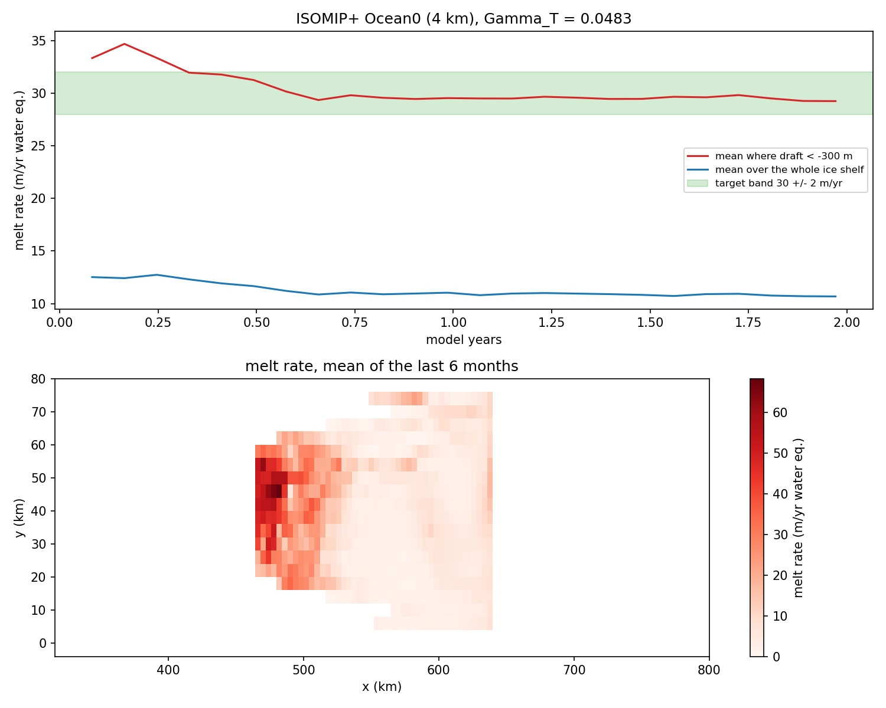

# 16. Melting under an ice shelf in MITgcm: how does melt depend on ocean temperature?

How fast does the ocean melt a floating ice shelf from below, and how does the melt rate depend on the ocean temperature outside the cavity, on the uncertain settings of the melt formula, and on the grid? I used MITgcm's `isomip` ice-shelf experiment, then set up the ISOMIP+ Ocean0 test case. This follows project 14, where a toy model assumed that melt grows with the square of the ocean temperature above freezing.

## Setup

- MITgcm `checkpoint69q`, experiment `isomip` with `pkg/shelfice`. The source is never changed; every changed file is in `experiments/`.
- A box from 80°S to 70°S, 50 x 100 points, 30 levels of 30 m over a flat 900 m seafloor, with a fixed ice shelf whose base rises from about 700 m to 200 m.
- From step 3, ice north of 71°S is removed and that open-ocean zone is restored to a chosen far-field temperature (salinity 34.4).
- Three-equation melt model (Holland and Jenkins 1999) with gamma_T = 1e-4 m/s.

## Key results

- **Melt grows faster than linearly with thermal forcing (TF):** melt = 0.104 x TF^1.52 for the three steady cases (TF^1.79 if the coldest, not-quite-steady case is included).
- **Compared with the -0.9 °C case:**
  - warming the far field by 1 °C doubles the melt;
  - halving or doubling gamma_T changes melt by only -13% and +13%, because the heat supply limits the melt;
  - velocity-dependent coefficients cut melt to 28%, because the currents next to the ice are only about 1 mm/s;
  - halving the grid spacing adds 9%, nearly all of it at the ice front.
- **Where the melt happens:** the warm restored water is lighter than the cavity water, so it stays near the ice front. The row of ice behind the front produces about 30% of all melt, while the deep cavity stays at about -2.0 °C.
- **ISOMIP+ Ocean0 (4 km):** Gamma_T = 0.0483 gives 29.53 m/yr where the ice is deeper than 300 m, inside the 30 ± 2 m/yr target. Here the warm water is salty and dense, so the strongest melt (up to 68 m/yr) is at the deep grounding line.







## Checks

- My build reproduces the official `isomip` output (at least 7.5 significant digits).
- The salt budget of the sealed baseline closes to within 0.08%.
- Every run ended normally, with no NaN.

## Limitations

- Idealized geometry and a fixed ice shape: no thinning and no grounding-line motion.
- Coarse grid: the melt at the ice front is not converged (20% more on the finer grid). ISOMIP+ was run at 4 km instead of the specified 2 km.
- No tides, sea ice or atmosphere.
- Uniform far-field salinity, so warm water never reaches the deep grounding zone, unlike real Circumpolar Deep Water.
- 13 deviations from the ISOMIP+ specification, listed in notebook 07. A failed first design (restoring under the ice) is documented in notebook 03.

## Notebooks

| Notebook | Content |
| :--- | :--- |
| `01_build_and_verify` | Build, reference-output check, melt settings, timing |
| `02_baseline_cavity` | 5-year baseline: melt map, sections, circulation, ice pump |
| `03_melt_vs_ocean_temperature` | Four far-field temperatures, power-law fit |
| `04_melt_parameter_sensitivity` | gamma_T halved/doubled, velocity-dependent coefficients |
| `05_checks_and_summary` | Salt budget, summary, comparison with project 14 |
| `06_resolution_test` | The -0.9 °C case on a finer grid |
| `07_isomip_plus_ocean0` | ISOMIP+ Ocean0, Gamma_T calibration, deviations |

## How to reproduce

The MITgcm source (0.5 GB) and all runs (3.4 GB) live outside the repository. Requirements: macOS on Apple silicon with Homebrew `gfortran`, `make` and netCDF, the repository's conda environment plus MITgcmutils, and for step 7 the ISOMIP+ geometry file `Ocean1_input_geom_v1.01.nc` (doi:10.5880/PIK.2016.002) in `~/mitgcm_runs/isomip/isomip_plus_data/`.

```bash
# Get MITgcm and copy the experiment
git clone --depth 1 --branch checkpoint69q https://github.com/MITgcm/MITgcm.git ~/models/MITgcm
python -m pip install --no-deps ~/models/MITgcm/utils/python/MITgcmutils
mkdir -p ~/mitgcm_runs/isomip/source_copy
cp -R ~/models/MITgcm/verification/isomip/{code,input,results} ~/mitgcm_runs/isomip/source_copy/

# Build (from inside project_16_mitgcm_ice_shelf_cavity/)
C=~/mitgcm_runs/isomip/source_copy/code; B=~/mitgcm_runs/isomip
bash scripts/build.sh $C $B/build_reference_ieee ieee
bash scripts/build.sh $C $B/build_safe_fast fast experiments/safety_code
bash scripts/build.sh $C $B/build_rbcs_fast fast experiments/rbcs_code
bash scripts/build.sh $C $B/build_fine_fast fast experiments/fine_code
bash scripts/build.sh $C $B/build_isoplus_fast fast experiments/isomip_plus_code

# Run (first run "Part A" of notebooks 03, 06 and 07, which writes the input files)
I=~/mitgcm_runs/isomip/source_copy/input
bash scripts/run_experiment.sh $B/build_reference_ieee $I $B/reference_test_ieee
bash scripts/run_experiment.sh $B/build_safe_fast $I $B/baseline experiments/baseline/input    # 43 min
bash scripts/run_open_cases.sh $B/inputs_rbcs base p05 p10 p20                                 # 2.9 h
bash scripts/run_extension.sh $B/inputs_rbcs base_ext                                          # 2.4 h
bash scripts/run_extension.sh $B/inputs_rbcs p05_ext
bash scripts/run_open_cases.sh $B/inputs_rbcs g05 g20 frict                                    # 2.9 h
bash scripts/run_fine_case.sh $B/inputs_fine fine_p10                                          # 2.2 h
bash scripts/run_isoplus_cases.sh isoplus_g025 isoplus_g050 isoplus_g100 isoplus_g200         # 1.1 h
bash scripts/run_isoplus_cases.sh isoplus_final                                                # 1.5 h
```

Then run the notebooks 01 to 07 in order; they read the runs from `~/mitgcm_runs/isomip/`. The failed first design can be rerun with `bash scripts/run_rbcs_cases.sh`.

## References

- Holland, D. M., and A. Jenkins (1999). Modeling thermodynamic ice-ocean interactions at the base of an ice shelf. Journal of Physical Oceanography, 29, 1787-1800.
- Losch, M. (2008). Modeling ice shelf cavities in a z coordinate ocean general circulation model. Journal of Geophysical Research, 113, C08043.
- Holland, P. R., A. Jenkins and D. M. Holland (2008). The response of ice shelf basal melting to variations in ocean temperature. Journal of Climate, 21, 2558-2572.
- Asay-Davis, X. S., et al. (2016). Experimental design for three interrelated marine ice sheet and ocean model intercomparison projects: MISMIP v. 3 (MISMIP+), ISOMIP v. 2 (ISOMIP+) and MISOMIP v. 1 (MISOMIP1). Geoscientific Model Development, 9, 2471-2497.
- Cornford, S., and X. Asay-Davis (2016). Ice-shelf surface, basal and bedrock topography data for the second Ice Shelf-Ocean Model Intercomparison Project (ISOMIP+). GFZ Data Services, doi:10.5880/PIK.2016.002.
- MITgcm documentation: https://mitgcm.readthedocs.io
