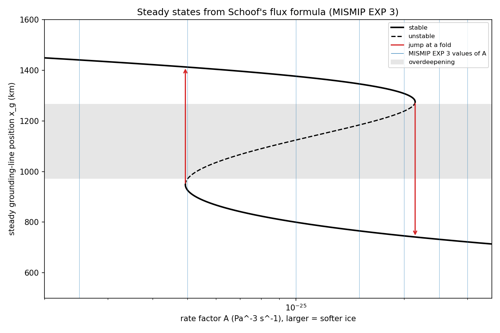
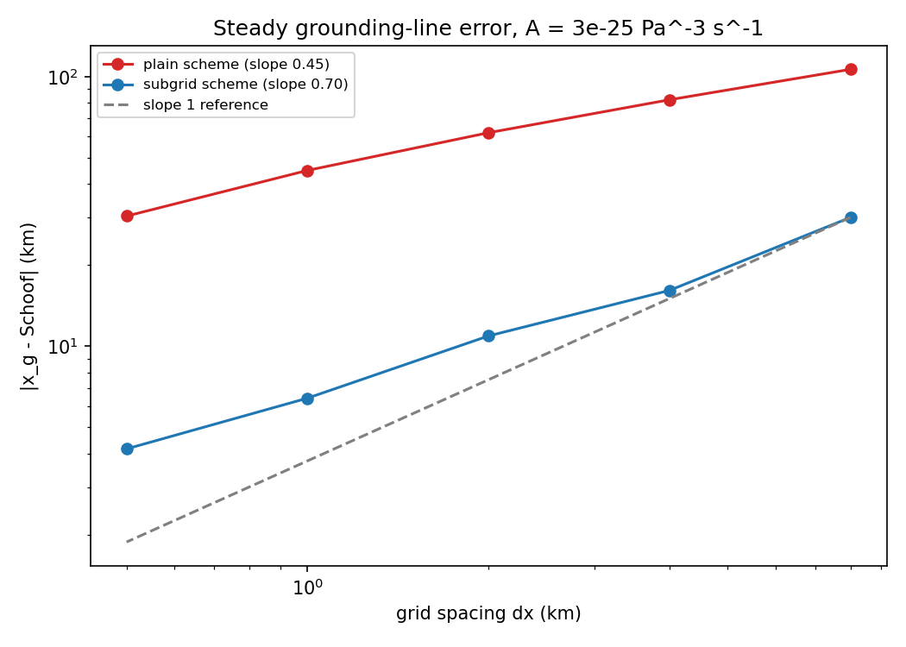
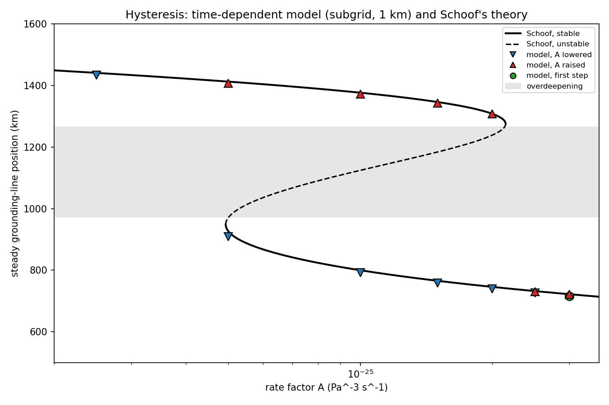

# 17. A marine ice-sheet flowline model: instability, hysteresis and grid resolution

Can a marine ice sheet (one resting on a bed below sea level) have unstable grounding-line positions and jump between steady states with hysteresis? And how much does a numerical model's answer depend on its grid? I wrote my own 1D flowline model in Python and reproduced the marine ice-sheet instability of Schoof (2007) on the MISMIP experiment 3 bed (Pattyn et al. 2012).

## Model

- Velocity from the shallow-shelf approximation with Glen's flow law, solved by Picard iteration with a tridiagonal solve; thickness from mass conservation with upwind fluxes; staggered grid.
- MISMIP 3 bed with an overdeepening (bed getting deeper inland) between 973.7 and 1265.7 km; A stepped from 3e-25 down to 2.5e-26 Pa^-3 s^-1 and back; calving front fixed at 1600 km.
- Two grounding-line schemes: plain (each cell edge grounded or floating) and sub-grid (friction scaled by the grounded fraction of the cell, after Gladstone et al. 2010 and Leguy et al. 2014).
- All model functions are in `notebooks/flowline.py`.

## Key results

- **Theory:** Schoof's formula gives two stable grounding-line positions for 4.930e-26 < A < 2.145e-25, with forced jumps of 464.6 km forward and 533.7 km back across the overdeepening.
- **Grid resolution matters a lot:** for A = 3e-25 (Schoof: 721.90 km), the plain scheme stops 106.45 km short at 8 km spacing and still 30.40 km short at 0.5 km. The sub-grid scheme is 30.06 km and 4.16 km short.
- **Hysteresis reproduced:** at 1 km with the sub-grid scheme, the model follows Schoof's stable branches within 7.3 km (17.6 km next to the lower fold), and for four values of A it has two steady states depending on its history.
- **Slow jumps:** crossing the overdeepening takes 5800 years forward and 7500 years back.
- **No buttressing in 1D:** melting the ice shelf from 258 m to 8.5 m thick does not move the grounding line.







## Checks

- The velocity solver matches exact ice-shelf solutions (convergence rate 2.001).
- Ice mass is conserved to a relative difference of 1.87e-14.
- A basal stress of 80 kPa gives 36.46 m/yr of sliding, against "about 35 m/yr" in Schoof (2007).

## Limitations

- 1D only: no sideways flow, so no buttressing.
- Power-law sliding with fixed C, and a fixed calving front.
- A simple sub-grid scheme, and explicit time stepping that limits the grid to 0.5 km or coarser.

## Notebooks

| Notebook | Content |
| :--- | :--- |
| `01_schoof_steady_states` | Schoof's flux formula, steady states, stability, hysteresis loop |
| `02_velocity_solver_and_shelf_test` | Velocity solver tested against exact shelf solutions |
| `03_time_dependent_model_and_resolution` | Time stepping, grid spacings 8 to 0.5 km, both schemes |
| `04_hysteresis_experiment` | 13 MISMIP values of A, down and back up |
| `05_checks_and_summary` | Mass check, summary, shelf-melt tests |

## How to run

Needs numpy, scipy, matplotlib and Jupyter only. Run the notebooks in `notebooks/` in order, 01 to 05 (notebook 03 takes about 8 minutes, 04 about 6, the rest under a minute):

```bash
cd notebooks
jupyter nbconvert --to notebook --execute --inplace 01_schoof_steady_states.ipynb
```

## References

- Weertman, J. (1974). Stability of the junction of an ice sheet and an ice shelf. Journal of Glaciology, 13(67), 3-11.
- Schoof, C. (2007). Ice sheet grounding line dynamics: Steady states, stability, and hysteresis. Journal of Geophysical Research, 112, F03S28.
- Gladstone, R. M., A. J. Payne and S. L. Cornford (2010). Parameterising the grounding line in flow-line ice sheet models. The Cryosphere, 4, 605-619.
- Pattyn, F., et al. (2012). Results of the Marine Ice Sheet Model Intercomparison Project, MISMIP. The Cryosphere, 6, 573-588.
- Leguy, G. R., X. S. Asay-Davis and W. H. Lipscomb (2014). Parameterization of basal friction near grounding lines in a one-dimensional ice sheet model. The Cryosphere, 8, 1239-1259.
- Seroussi, H., and M. Morlighem (2018). Representation of basal melting at the grounding line in ice flow models. The Cryosphere, 12, 3085-3096.
- Wang, Y., et al. (2024). Sensitivity of the future evolution of the Wilkes Subglacial Basin ice sheet to grounding-line melt parameterizations. The Cryosphere, 18, 5117-5137.
- Cuffey, K. M., and W. S. B. Paterson (2010). The Physics of Glaciers, 4th edition. Butterworth-Heinemann.
