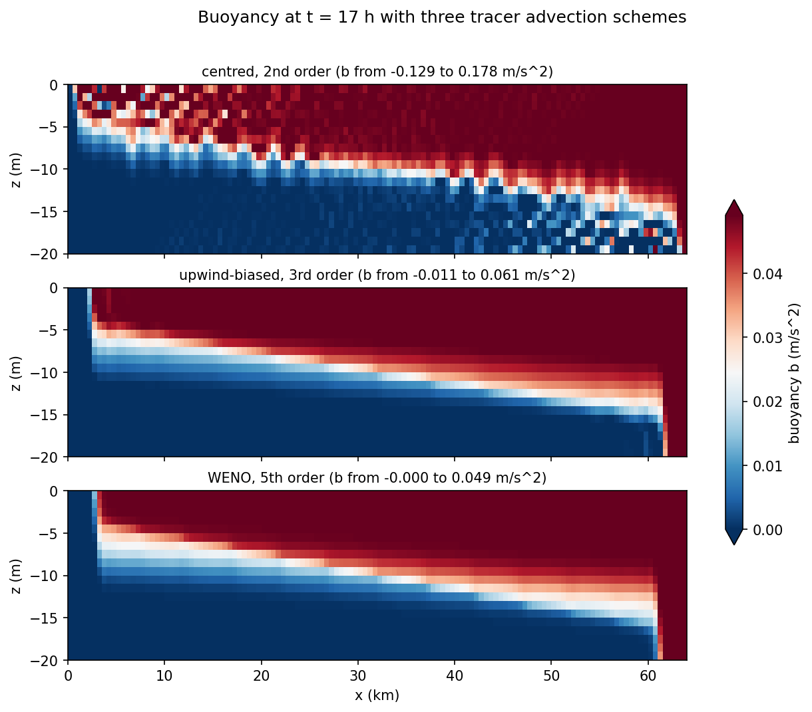
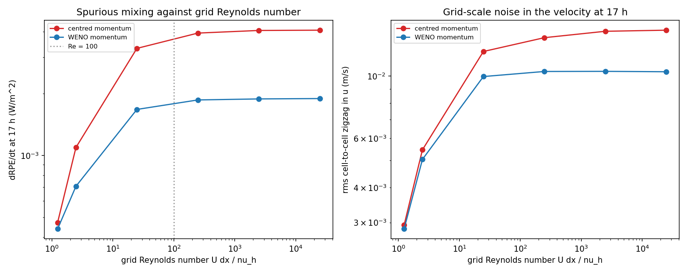
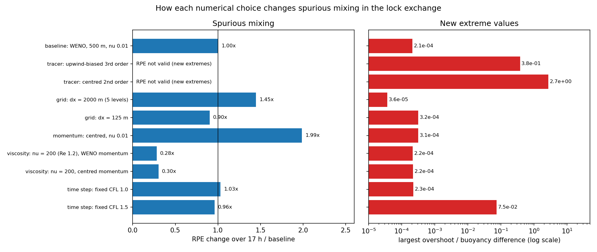

# 18. Numerical mixing in an ocean model: the lock-exchange test in Oceananigans.jl

How much artificial ("spurious") mixing do the numerical choices in an ocean model create? With zero explicit diffusivity, any mixing between two water masses can only come from the numerics. I used the lock-exchange test of Ilicak et al. (2012) in Oceananigans.jl and varied the tracer advection scheme, grid resolution, viscosity and time step over 34 runs.

## Setup

- Oceananigans 0.113.5 on Julia 1.13.1 (hydrostatic model, laptop CPU); analysis in Python.
- A 2D channel, 64 km long and 20 m deep, with dense and light water (5 kg/m^3 difference) side by side at rest. Baseline grid dx = 500 m, dz = 1 m; each run lasts 17 hours.
- Mixing measured by the reference potential energy (RPE), buoyancy variance, and overshoots beyond the starting buoyancy range.
- In this Oceananigans version the TimeStepWizard's viscous limit treats the Flat y-direction as 1 m wide, so I passed the real limit myself (minimal example in `simulations/mwe_flat_y_diffusion_timescale.jl`).

## Key results

- **The tracer scheme decides whether new water masses appear.** The centred scheme overshoots by up to 2.7 buoyancy differences; WENO stays within the starting range (overshoots of 2e-4).
- **A finer grid helps little.** Going 16 times finer (2000 m to 125 m) cut WENO mixing only 1.6 times, while the centred scheme's overshoots grew from 0.8 to 5.8.
- **Viscosity matters.** Mixing is capped above a grid Reynolds number of about 100 and falls below about 25: at Re = 1.24 it is 8.6 times smaller with centred momentum and 4.3 times smaller with WENO momentum.
- **Time step.** Up to CFL 1 it hardly matters; at CFL 2.0 overshoots reach 3.3, and from 2.5 the run blows up.
- **Why it matters:** in century-long climate runs spurious mixing acts all the time and can erode water-mass contrasts. This 2D, 17-hour test shows the mechanism, not its size in a climate model.

## Checks

- Front speed 0.4793 m/s, 3.2% slower than the theory of Benjamin (1968), 0.4952 m/s.
- Total buoyancy conserved to 2.2e-8 in all 34 runs.
- RPE never decreases for WENO. It fails for the non-monotone schemes, whose new extremes lower it, so those runs are flagged instead of being read as less mixing.

## Limitations

- 2D only, in one idealized test (no rotation, forcing or topography).
- Finest grid dx = 125 m on a laptop, with dx and dz scaled together.
- RPE from 10-minute snapshots, which underestimates mixing for non-monotone schemes.

## Notebooks

| Notebook | Content |
| :--- | :--- |
| `01_setup_and_first_run` | Test run from Julia to a Python plot |
| `02_lock_exchange_baseline` | Baseline (WENO, dx = 500 m) and checks |
| `03_advection_schemes` | Centred, upwind-biased and WENO tracer advection |
| `04_resolution` | dx = 2000 to 125 m |
| `05_viscosity_and_grid_reynolds_number` | Lateral viscosity 0.01 to 200 m^2/s |
| `06_time_step_and_stability` | Fixed time steps CFL 0.2 to 4.0, and adaptive |
| `07_summary` | All 34 runs (`data/summary_all_runs.csv`) and conclusions |

## How to reproduce

1. Install Julia (1.13.1) and the exact package versions from this folder:

       julia --project=. -e 'using Pkg; Pkg.instantiate()'

2. Run `simulations/run_step1.jl` to `run_step6.jl` in order, e.g. `julia --project=. simulations/run_step2.jl`. Output goes to `~/oceananigans_runs/numerical_mixing/` (about 420 MB, about 5 minutes of computing in total).
3. Run the notebooks 01 to 07 in order with Python 3 (numpy, pandas, xarray with a NetCDF backend, matplotlib, Jupyter).

## References

- Benjamin, T. B. (1968). Gravity currents and related phenomena. Journal of Fluid Mechanics, 31(2), 209-248.
- Winters, K. B., Lombard, P. N., Riley, J. J. and D'Asaro, E. A. (1995). Available potential energy and mixing in density-stratified fluids. Journal of Fluid Mechanics, 289, 115-128.
- Griffies, S. M., Pacanowski, R. C. and Hallberg, R. W. (2000). Spurious diapycnal mixing associated with advection in a z-coordinate ocean model. Monthly Weather Review, 128(3), 538-564. https://doi.org/10.1175/1520-0493(2000)128<0538:SDMAWA>2.0.CO;2
- Ilıcak, M., Adcroft, A. J., Griffies, S. M. and Hallberg, R. W. (2012). Spurious dianeutral mixing and the role of momentum closure. Ocean Modelling, 45-46, 37-58. https://doi.org/10.1016/j.ocemod.2011.10.003
- Ramadhan, A., Wagner, G. L., Hill, C., Campin, J.-M., et al. (2020). Oceananigans.jl: Fast and friendly geophysical fluid dynamics on GPUs. Journal of Open Source Software, 5(53), 2018. https://doi.org/10.21105/joss.02018
- Oceananigans.jl documentation: https://clima.github.io/OceananigansDocumentation/stable/
